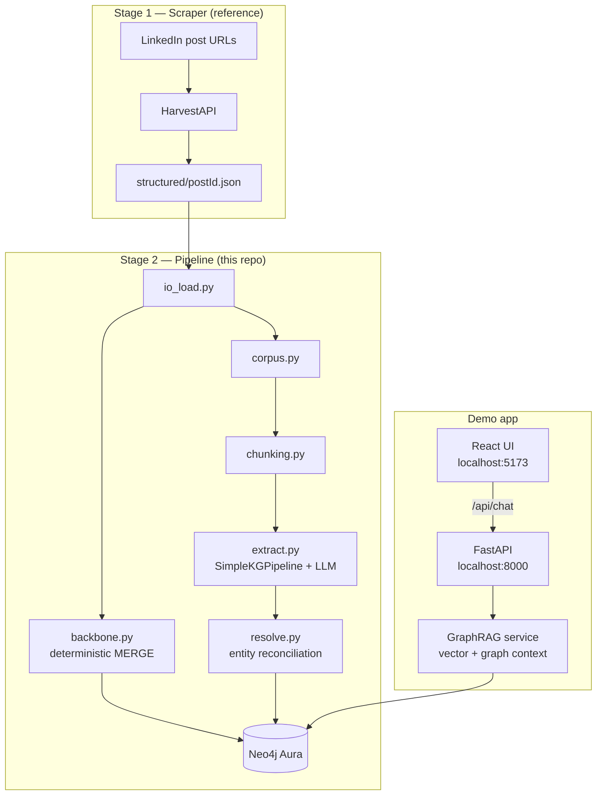
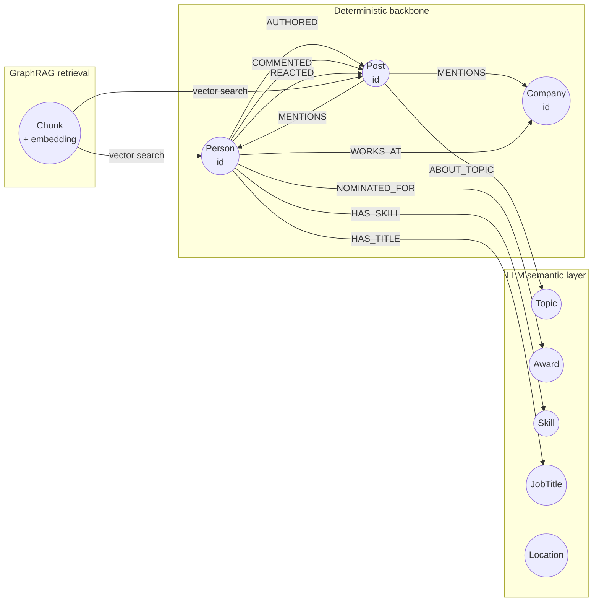
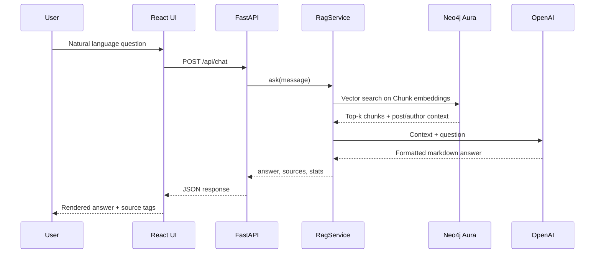

# LinkedIn Graph Intelligence

A hybrid knowledge-graph pipeline that turns LinkedIn post engagement data into a queryable Neo4j graph, enriched with an LLM semantic layer and a natural-language demo UI powered by GraphRAG.

```
Stage 1 (reference)   HarvestAPI scraper  →  structured/<postId>.json
Stage 2 (pipeline)    structured JSON     →  backbone + semantic layer  →  Neo4j Aura
Demo app              React UI            →  FastAPI                  →  GraphRAG
```

---

## Architecture overview

The system has three layers: **ingestion**, **graph building**, and **query/demo**.



### Hybrid graph model

The graph deliberately splits into two layers:

| Layer | Built by | Key rule |
|---|---|---|
| **Deterministic backbone** | `backbone.py` | `Person`, `Post`, `Company` merged on stable LinkedIn IDs. Social edges (`AUTHORED`, `COMMENTED`, `REACTED`, `MENTIONS`) created without LLM. |
| **LLM semantic layer** | `extract.py` | Entities like `Topic`, `Award`, `Skill`, `JobTitle` extracted from free text. Stub nodes reconciled back to backbone in `resolve.py`. |



### Demo query flow

When a user asks a question in the UI:



---

## Project structure

```
linkedin-graphrag-pipeline/
├── backend/
│   ├── api/
│   │   └── main.py              # FastAPI — /api/health, /api/stats, /api/chat
│   ├── rag/
│   │   └── service.py           # GraphRAG — VectorCypherRetriever + OpenAI LLM
│   └── pipeline/                # Stage 2 ETL
│       ├── config.py            # Settings from .env
│       ├── io_load.py           # Load + validate structured JSON
│       ├── backbone.py          # Deterministic Person/Post/edge MERGE
│       ├── corpus.py            # Build text records for LLM
│       ├── chunking.py          # RecordCountSplitter (30 records, overlap 5)
│       ├── schema.py            # GraphSchema for semantic extraction
│       ├── extract.py           # neo4j-graphrag SimpleKGPipeline
│       ├── resolve.py           # Reconcile LLM stubs + fuzzy entity merge
│       ├── neo4j_client.py      # Driver, constraints, indexes
│       └── pipeline.py          # Orchestrates backbone + semantic steps
├── frontend/                    # React + Vite demo UI
│   ├── src/
│   │   ├── App.tsx              # Chat interface
│   │   ├── index.css            # Theme + layout
│   │   └── lib/api.ts           # API client
│   └── vite.config.ts           # Proxies /api → localhost:8000
├── scripts/
│   ├── 01_load_backbone.py      # Run deterministic graph load
│   ├── 02_build_semantic_graph.py
│   ├── run_all.sh               # Full Stage 2 pipeline
│   ├── start_api.py             # Uvicorn backend launcher
│   └── start_demo.sh            # Start API + UI together
├── config/
│   └── kg_pipeline.yaml         # SimpleKGPipeline config reference
├── data/
│   ├── raw/                     # structured JSON input (gitignored)
│   └── processed/               # Debug corpus/chunks (gitignored)
├── reference/                   # Read-only reference code + docs
│   ├── linkedin_scraper/        # Stage 1 HarvestAPI scraper
│   └── neo4j_graphrag_docs.md
├── tests/
│   ├── fixtures/                # Sample post JSON
│   ├── test_backbone.py
│   ├── test_chunking.py
│   └── test_schema.py
├── .env.example
├── requirements.txt
├── package.json                 # npm run dev → start_demo.sh
├── GOVERNANCE.md                # GDPR / data handling
└── README.md
```

### Module map

| Module | Responsibility |
|---|---|
| `io_load.py` | Reads `data/raw/*.json`, validates schema contract |
| `backbone.py` | Idempotent Cypher MERGE for people, posts, comments, reactions, mentions |
| `corpus.py` | Turns post/comment/profile text into LLM records |
| `chunking.py` | Groups records into chunks (default 30, overlap 5) |
| `schema.py` | Node/rel types and patterns for semantic extraction |
| `extract.py` | Runs `SimpleKGPipeline` with OpenAI LLM + embeddings |
| `resolve.py` | Merges LLM person/post stubs into backbone; fuzzy-matches semantic entities |
| `rag/service.py` | Vector search + LLM answer generation for demo chat |

---

## Prerequisites

| Tool | Version | Purpose |
|---|---|---|
| Python | 3.11+ | Pipeline + API |
| Node.js | 18+ | Demo UI |
| Neo4j Aura | — | Graph database (cloud) |
| OpenAI API key | — | Semantic extraction + chat |

---

## Setup

### 1. Clone and install

```bash
git clone <repo-url>
cd linkedin-graphrag-pipeline

python3 -m venv .venv
source .venv/bin/activate          # Windows: .venv\Scripts\activate
pip install -r requirements.txt
```

### 2. Configure environment

```bash
cp .env.example .env
```

Edit `.env` with your credentials:

| Variable | Required | Description |
|---|---|---|
| `NEO4J_URI` | Yes | Aura URI, e.g. `neo4j+s://xxxx.databases.neo4j.io` |
| `NEO4J_USER` | Yes | Default `neo4j` (`NEO4J_USERNAME` also accepted) |
| `NEO4J_PASSWORD` | Yes | Aura instance password |
| `NEO4J_DATABASE` | Yes | Default `neo4j` |
| `OPENAI_API_KEY` | Yes | Semantic extraction + demo chat |
| `LLM_MODEL` | No | Default `gpt-4o-mini` |
| `EMBED_MODEL` | No | Default `text-embedding-3-small` |
| `HARVEST_API_KEY` | No | Only for Stage 1 scraper |
| `INPUT_DIR` | No | Default `data/raw` |
| `INCLUDE_REACTOR_PROFILES` | No | Default `false` |

### 3. Add input data

Place structured post JSON files in `data/raw/` (one file per post):

```bash
mkdir -p data/raw
cp tests/fixtures/7470802348391673856.json data/raw/
```

Or sync output from the Stage 1 scraper in `reference/linkedin_scraper/`.

---

## Run the pipeline

Loads the graph into Neo4j. Safe to re-run — all steps are idempotent.

```bash
bash scripts/run_all.sh
```

Or step by step:

```bash
export PYTHONPATH=.

python scripts/01_load_backbone.py          # deterministic graph
python scripts/02_build_semantic_graph.py   # LLM extraction + vectors + resolution
```

**Step 1** creates people, posts, comments, reactions, and mention edges from structured IDs.

**Step 2** builds a text corpus, runs LLM entity extraction, embeds chunks, and resolves duplicate entities.

---

## Run the demo app

One command starts both the backend API and the React UI:

```bash
npm run dev
```

| Service | URL |
|---|---|
| **UI** | http://127.0.0.1:5173 |
| **API** | http://127.0.0.1:8000 |
| **Health check** | http://127.0.0.1:8000/api/health |

Press **Ctrl+C** to stop both servers.

The script auto-activates `.venv`, waits for the API health check, and installs frontend deps on first run.

### Example questions

- *Who commented on the post and what did they say?*
- *Summarize the post engagement and key themes.*
- *Which companies and awards were mentioned?*
- *Who are the most active commenters?*

---

## API reference

| Method | Endpoint | Description |
|---|---|---|
| `GET` | `/api/health` | Health check |
| `GET` | `/api/stats` | Node counts (people, posts, comments, chunks) |
| `POST` | `/api/chat` | Natural language query |

**Chat request:**

```json
{
  "message": "Who commented on the post?",
  "top_k": 8
}
```

**Chat response:**

```json
{
  "answer": "markdown formatted answer",
  "sources": [{ "postId": "...", "source": "..." }],
  "graph_stats": { "people": 198, "posts": 1, "comments": 24, "chunks": 6 },
  "retrieval_mode": "vector+cypher"
}
```

---

## Teammate quick start

Share these with new team members:

1. **Repo URL** and a filled `.env` (via secure channel — never commit secrets)
2. **Sample data** in `data/raw/`, or confirm the shared Aura DB is already loaded
3. Run:

```bash
python3 -m venv .venv && source .venv/bin/activate
pip install -r requirements.txt
cp .env.example .env            # fill in secrets from team lead

bash scripts/run_all.sh         # first time only (loads graph)
npm run dev                     # start UI + API
# → open http://127.0.0.1:5173
```

---

## Tests

```bash
source .venv/bin/activate
PYTHONPATH=. pytest tests/ -q
```

---

## Useful Cypher queries

**All commenters on a post:**

```cypher
MATCH (p:Person)-[c:COMMENTED]->(post:Post)
RETURN p.name, p.headline, c.commentary
ORDER BY p.name
```

**Graph counts:**

```cypher
MATCH (n) RETURN labels(n)[0] AS label, count(n) AS count ORDER BY count DESC
```

**People mentioned in a post:**

```cypher
MATCH (post:Post)-[:MENTIONS]->(target)
RETURN post.id, labels(target)[0] AS type, target.name
```

---

## Data governance

This pipeline processes personal data (names, headlines, locations, comments). See [GOVERNANCE.md](GOVERNANCE.md) for GDPR considerations, retention, and deletion procedures before production use.

---

## Scripts reference

| Command | What it does |
|---|---|
| `npm run dev` | Start API + UI together |
| `npm run api` | Start API only |
| `npm run ui` | Start UI only |
| `npm run pipeline` | Run full Stage 2 pipeline |
| `bash scripts/run_all.sh` | Same as pipeline |
| `bash scripts/start_demo.sh` | Same as `npm run dev` |

---

## Tech stack

| Layer | Technology |
|---|---|
| Graph database | [Neo4j Aura](https://neo4j.com/cloud/aura/) |
| GraphRAG | [neo4j-graphrag](https://neo4j.com/docs/neo4j-graphrag-python/) |
| LLM + embeddings | OpenAI (`gpt-4o-mini`, `text-embedding-3-small`) |
| Backend API | FastAPI + Uvicorn |
| Frontend | React 18 + Vite + TypeScript |
| Entity resolution | RapidFuzz fuzzy matching |
| Stage 1 scraper | HarvestAPI (reference only) |
